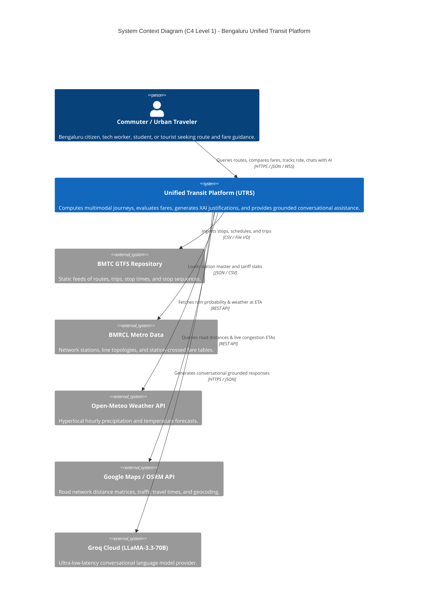
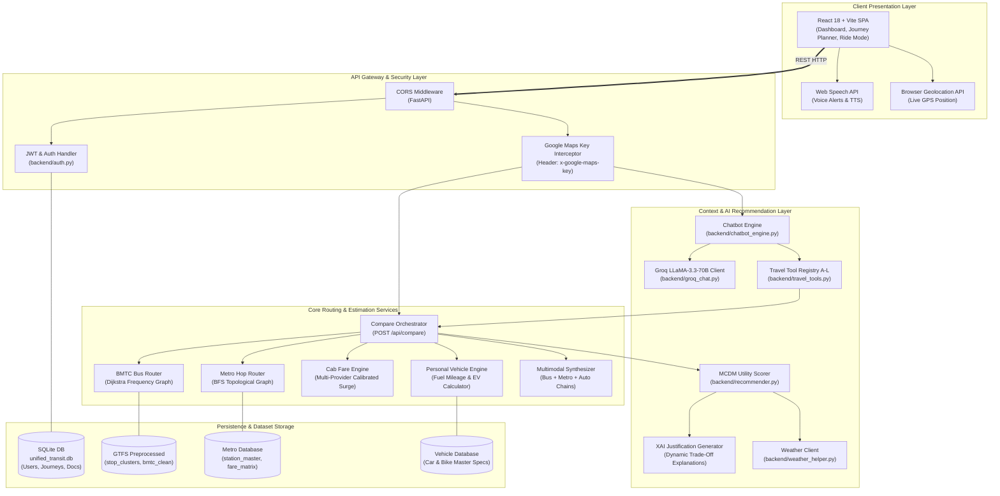
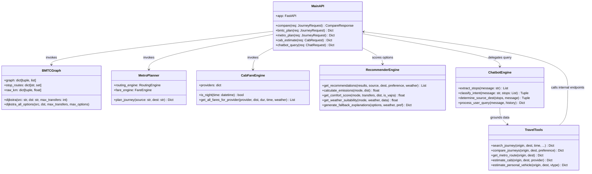
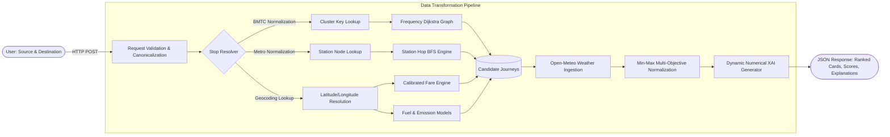
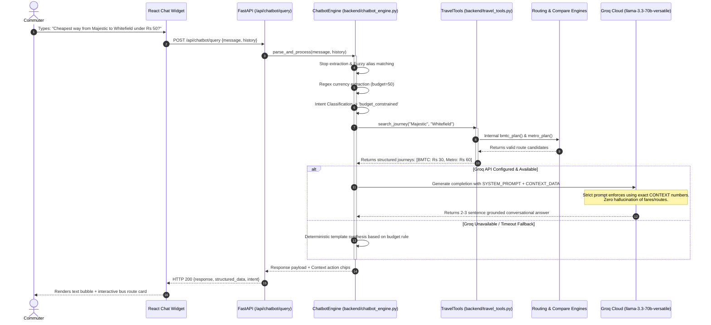
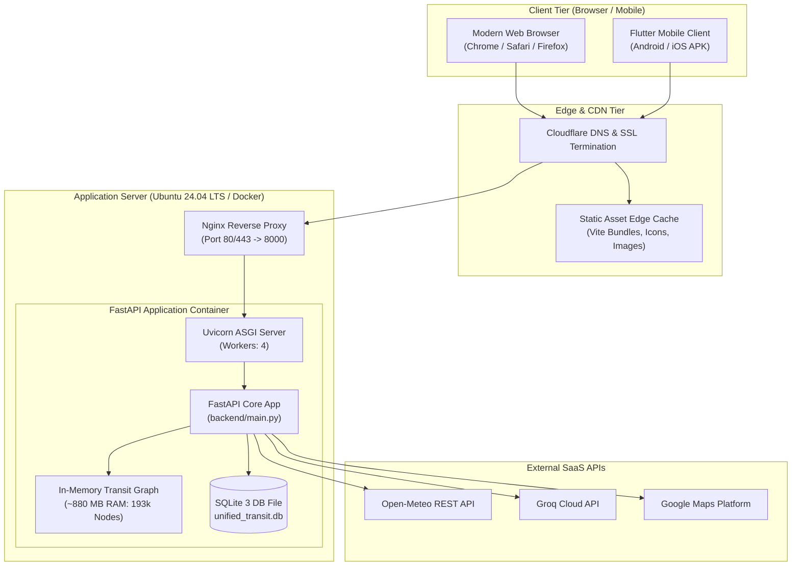

# PART II: SYSTEM ARCHITECTURE AND DETAILED WORKFLOWS

---

## Chapter 6: High-Level Architecture

### 6.1 Architectural Principles and System Context

The **Unified Transit Routing & Recommendation System (UTRS)** is architected as a modular, decoupled full-stack platform. It separates computationally intensive public-transit graph operations from ride-hailing pricing simulations, environmental context ingestion, and conversational AI interfaces.

The architecture addresses three critical challenges of urban multimodal transit:
1. **Heterogeneous Modality Processing:** Processing high-density, static public transit schedules (GTFS) alongside dynamic, parameter-driven ride-hailing models without blocking server threads.
2. **Context-Grounded Artificial Intelligence:** Preventing conversational AI hallucinations by decoupling intent parsing from travel execution, ensuring that LLM prompts are conditioned on deterministic backend data.
3. **Resilience via Deterministic Fallbacks:** Providing graceful offline degradation if third-party services (such as Google Maps, Open-Meteo, or Groq) experience transient timeouts or network partitions.

---

### 6.2 Architectural Diagrams (Mermaid)

#### 1. System Context Diagram (C4 Level 1)
This diagram illustrates how users and external services interact with the UTRS platform boundaries.



---

#### 2. High-Level Architecture Diagram (C4 Level 2 - Container Layer)
This diagram captures the internal architectural tiers of the UTRS server and client ecosystem.



---

#### 3. Component Diagram (C4 Level 3 - Backend Core)
This diagram illustrates the fine-grained code modules and internal interfaces within the FastAPI backend.



---

#### 4. Data-Flow Diagram (DFD Level 1)
This diagram traces data transformations from raw input to enriched UI output.



---

#### 5. Chatbot Architecture Diagram
This diagram reveals how conversational requests are parsed, validated, grounded against deterministic tools, and synthesized by Groq LLaMA-3.3-70B.



---

#### 6. Deployment Diagram
This diagram outlines the target containerized deployment configuration.



---

## Chapter 7: Low-Level Design

### 7.1 Module Responsibilities & Class Relationships

```
backend/
├── main.py                     ── Application entry point; registers all 48 HTTP endpoints; initializes singletons.
├── auth.py                     ── JWT generation, password hashing (bcrypt), and current user dependency injection.
├── db.py                       ── SQLAlchemy engine, declarative models (User, SavedJourney, Vehicle, Document).
├── groq_chat.py                ── LLaMA-3.3-70B API wrapper with strict anti-hallucination system prompts.
├── chatbot_engine.py           ── Rule-based NLP intent parser, stop name alias resolution, and deterministic fallback.
├── travel_tools.py             ── Standardized deterministic tools (A through L) interfacing with backend solvers.
├── recommender.py              ── MCDM Multi-Objective Utility Engine, min-max normalization, dynamic XAI builder.
├── weather_helper.py           ── Open-Meteo REST API client; caches forecasts by latitude/longitude.
├── location_aliases.py         ── Curated dictionary of 200+ colloquial Bengaluru place synonyms and Kannada aliases.
├── poi_data.py                 ── Master catalog of 150+ Bengaluru landmarks, IT parks, colleges, and hospitals.
│
├── modes/
│   ├── bmtc/                   ── Bus routing subsystem:
│   │   ├── core/loader.py      ── Reads `bmtc_stop_level_cleaned.csv` and compiles `ALL_STOPS`.
│   │   ├── core/graph.py       ── Builds 193k-node graph; implements single and multi-path Dijkstra.
│   │   ├── features/routing.py ── Orchestrates direct route lookups and transfer-point searches.
│   │   ├── features/fare.py    ── Slabs for Ordinary, Vajra, KIA express, and toll surcharges.
│   │   └── features/schedule.py── Estimates segment travel times across peak, day, and night speed profiles.
│   │
│   ├── metro/                  ── Rail routing subsystem:
│   │   ├── engines/routing_engine.py ── Undirected MetroGraph; BFS shortest-path hop traversal.
│   │   ├── engines/fare_engine.py    ── Stations-crossed lookup against `fare_matrix.csv` with peak/off-peak smart card discounts.
│   │   └── planner/journey_planner.py── Combines BFS station traversal with line-change detection.
│   │
│   └── cab/                    ── Ride-hailing subsystem:
│       └── engines/fare_engine.py    ── Multi-provider rate tables, deadhead distance, and surge multipliers.
│
└── multimodal/                 ── Cross-modal subsystem:
    ├── interchange_matcher.py  ── Matches bus stops within 500m walking radius of metro stations.
    └── router.py               ── Synthesizes BMTC Leg 1 + Metro Trunk + BMTC/Walk Leg 2 journeys.
```

---

### 7.2 Core Data Models & Pydantic Schemas

Below are the primary Pydantic schemas defined in [`backend/main.py`](file:///c:/Users/Harsh/Downloads/BMTC_fixed/backend/main.py) governing request and response validation:

```python
class JourneyRequest(BaseModel):
    source: str = Field(..., example="Majestic")
    destination: str = Field(..., example="Indiranagar")
    time: Optional[str] = Field(None, example="09:30 AM")
    preference: Optional[str] = Field("cost", example="cost")  # "cost", "time", "convenience", "least_walking"

class CabEstimateRequest(BaseModel):
    src_lat: float = Field(..., example=12.9716)
    src_lng: float = Field(..., example=77.5946)
    dst_lat: float = Field(..., example=12.9279)
    dst_lng: float = Field(..., example=77.6271)
    weather: Optional[str] = Field("clear", example="heavy rain")

class ChatbotRequest(BaseModel):
    message: str = Field(..., example="Cheapest bus to Electronic City?")
    history: Optional[List[Dict[str, Any]]] = Field(default_factory=list)
    session_id: Optional[str] = Field(None, example="sess_123456")

class UserAuthRequest(BaseModel):
    username: str = Field(..., min_length=3, max_length=50)
    password: str = Field(..., min_length=6)

class UserAuthResponse(BaseModel):
    status: str
    access_token: str
    token_type: str = "bearer"
    username: str
```

---

### 7.3 Error Propagation & Exception Handling Hierarchy

The backend implements a structured exception-handling protocol:
1. **HTTP Layer (`HTTPException`):** Handles client-facing errors (e.g., HTTP 404 for unknown stop names, HTTP 401 for expired JWTs, HTTP 422 for malformed coordinate payloads).
2. **Graceful Fallback on External Failures:**
   - **Groq API failure:** If `generate_groq_reply()` encounters network timeouts, missing keys, or rate limits, it returns `None`. The caller silently delegates response generation to the deterministic `ChatbotEngine` without returning an error to the user.
   - **Open-Meteo API failure:** If the weather API times out, `weather_helper.py` returns a default `"clear"` weather state with 0% rain probability.
   - **Google Maps OSRM failure:** If road-network geometry fails to resolve, distance falls back to great-circle Haversine calculations multiplied by an urban routing detour index ($1.30$).
3. **No Unhandled Crashes:** All modal solvers catch internal execution exceptions and return an explicit `{"available": False, "error": str(e)}` dictionary rather than propagating unhandled 500 errors to the client.

---

## Chapter 21: Complete Application Workflow (End-to-End Walkthrough)

To understand how every architectural component collaborates, let us trace a single end-to-end user request:
**Scenario:** A commuter queries a trip from **"Kempegowda Bus Station (Majestic)"** to **"Central Silk Board"** at **08:30 AM** with preference set to **"cheapest"**.

```
[Step 1: Frontend User Input]
       │
       ▼
[Step 2: Input Normalization & Validation]
       │
       ▼
[Step 3: Geographic Geocoding & Coordinate Resolution]
       │
       ▼
[Step 4: Parallel Modal Routing Execution]
   ├── [Step 4a: BMTC GTFS Dijkstra Search]
   ├── [Step 4b: Namma Metro BFS Station-Hop Search]
   ├── [Step 4c: Multi-Provider Cab Fare Simulation]
   └── [Step 4d: Personal Vehicle Fuel Modeling]
       │
       ▼
[Step 5: Multimodal Synthesis (Bus + Metro Combination)]
       │
       ▼
[Step 6: Environmental Context Ingestion (Open-Meteo)]
       │
       ▼
[Step 7: Multi-Objective Utility Normalization & Scoring]
       │
       ▼
[Step 8: Dynamic XAI Natural Language Explanation Generation]
       │
       ▼
[Step 9: JSON Response Serialization]
       │
       ▼
[Step 10: Frontend Card Rendering & Map Geometry Display]
       │
       ▼
[Step 11: Conversational Chatbot Follow-Up Execution]
```

---

### Step-by-Step Execution Trace

#### Step 1: User Input
The user selects "Kempegowda Bus Station" in the source input and "Central Silk Board" in the destination input, chooses "08:30 AM", selects the "Cheapest" filter chip, and clicks "Find Best Routes".

#### Step 2: Input Normalization & Validation
- **Source File:** [`backend/shared/utils/stop_resolver.py`](file:///c:/Users/Harsh/Downloads/BMTC_fixed/backend/shared/utils/stop_resolver.py)
- The raw string `"Kempegowda Bus Station"` is passed to `clean_input_name()`.
- Alias lookup maps colloquial names (e.g., "KBS", "Majestic") to the official canonical stop string: `"Kempegowda Bus Station"`.
- Destination `"Central Silk Board"` is verified against the compiled `ALL_STOPS` catalog (14,137 clean stops).

#### Step 3: Coordinate Lookup
- **Source File:** [`backend/main.py`](file:///c:/Users/Harsh/Downloads/BMTC_fixed/backend/main.py#L124-L160)
- `get_stop_coords("Kempegowda Bus Station")` retrieves `(12.9778, 77.5724)`.
- `get_stop_coords("Central Silk Board")` retrieves `(12.9176, 77.6238)`.
- Great-circle Haversine distance is calculated as $8.74\text{ km}$; estimated road distance is $11.36\text{ km}$.

#### Step 4: Parallel Modal Routing Execution
The backend triggers five specialized solver engines:

1. **BMTC Bus Engine (`bmtc_plan`):**
   - Resolves canonical stop norms to cluster keys: `CK_MAJESTIC` and `CK_SILKBOARD`.
   - Priority queue Dijkstra inspects frequency-weighted edges.
   - Finds direct bus route **365** and **V-500D**.
   - Calculates distance ($11.2\text{ km}$), travel time ($52\text{ mins}$ based on peak speed $10\text{ km/h}$), and fare using ordinary slab: $11.2\text{ km} \rightarrow \text{₹}24$.
2. **Namma Metro Engine (`metro_plan`):**
   - Evaluates nearest stations: Majestic (Green/Purple interchange).
   - Destination Silk Board is checked against operational lines. (Note: Silk Board is on the upcoming Yellow Line; nearest operational Green line station is Rashtriya Vidyalaya Road, $4.2\text{ km}$ away).
   - Metro engine determines direct rail is not fully contiguous; returns feasible leg to RV Road (8 stations crossed, ₹32 fare, 18 mins).
3. **Cab Pricing Engine (`cab_estimate`):**
   - Distance: $11.36\text{ km}$, estimated duration: $38\text{ mins}$.
   - Morning peak multiplier (08:30 AM) triggers $\Delta_{\text{time}} = +0.25$.
   - Fares calculated:
     - ZipGo Auto: ₹145
     - NammaMove Auto: ₹152
     - SwiftCab Go: ₹285
     - GoRide Mini: ₹295
4. **Personal Vehicle Engine (`vehicle_estimate`):**
   - Reference vehicle: 15 km/L petrol car.
   - Litres required: $11.36 / 15.0 = 0.76\text{ L}$.
   - Fuel cost: $0.76 \times \text{₹}102.0 = \text{₹}77.5$.
   - Parking estimate: ₹30.0 $\rightarrow$ Total: ₹107.5.

#### Step 5: Multimodal Synthesis
- **Source File:** [`backend/multimodal/router.py`](file:///c:/Users/Harsh/Downloads/BMTC_fixed/backend/multimodal/router.py)
- Explores Metro from Majestic to Banashankari + feeder bus 500D from Banashankari to Silk Board.
- Total fare: ₹25 (Metro) + ₹15 (Bus) = ₹40; Total duration: 38 mins (including 10-min transfer buffer).

#### Step 6: Environmental Context Ingestion
- **Source File:** [`backend/weather_helper.py`](file:///c:/Users/Harsh/Downloads/BMTC_fixed/backend/weather_helper.py)
- Queries Open-Meteo for coordinates `(12.9176, 77.6238)` at 09:15 AM (ETA).
- Returns: Temperature $26.4^\circ\text{C}$, Rain probability $12\%$, Condition `"Clear"`.

#### Step 7: Multi-Objective Utility Normalization & Scoring
- **Source File:** [`backend/recommender.py`](file:///c:/Users/Harsh/Downloads/BMTC_fixed/backend/recommender.py#L320-L362)
- Preference is `"cheapest"` $\rightarrow$ Weights: $\text{Cost}=0.55$, $\text{Time}=0.15$, $\text{Comfort}=0.05$, $\text{Eco}=0.05$, $\text{Weather}=0.10$, $\text{Traffic}=0.10$.
- Extracted costs: [BMTC: ₹24, Multimodal: ₹40, Personal: ₹107, Auto: ₹145, Cab: ₹285].
- Normalization awards BMTC $f_{\text{cost}} = 1.00$.
- Calculated composite utility scores:
  - **BMTC Bus:** **94.8 / 100** (Rank 1 - CHEAPEST)
  - **Multimodal (Metro+Bus):** **86.2 / 100** (Rank 2 - BALANCED)
  - **Auto (ZipGo):** **74.1 / 100** (Rank 3 - DOOR-TO-DOOR)
  - **Personal Car:** **68.5 / 100** (Rank 4)
  - **Cab (SwiftCab/GoRide):** **59.2 / 100** (Rank 5)

#### Step 8: Dynamic XAI Explanation Generation
- **Source File:** [`backend/recommender.py`](file:///c:/Users/Harsh/Downloads/BMTC_fixed/backend/recommender.py#L159-L230)
- BMTC explanation generated:
  > *"🚌 Direct BMTC Bus service (Route 365) takes ~52 mins over 11.2 km for ₹24, saving up to ₹261 compared to private cabs with minimal carbon emissions (280g CO2)."*
- Multimodal explanation generated:
  > *"🚌+🚇 Multimodal option combines rapid Metro transit with feeder bus coverage, completing 11.4 km in 38 mins for ₹40, bypassing arterial road gridlock."*

#### Step 9: JSON Serialization & HTTP Response
The API returns HTTP 200 with complete structured options, segment geometries, fare breakdowns, and recommendation metadata.

#### Step 10: Frontend UI Rendering
- **Source File:** [`frontend/src/App.jsx`](file:///c:/Users/Harsh/Downloads/BMTC_fixed/frontend/src/App.jsx#L10749-L11200)
- Results view mounts automatically.
- Rank 1 option displays a prominent green `"CHEAPEST"` badge with detailed bus stops expandable inline.
- Interactive map renders the bus path polyline along Hosur Road.

#### Step 11: Conversational Chatbot Follow-Up
- The user clicks the floating AI assistant chip: *"Will it rain during this trip?"*
- Chatbot engine detects `weather_query` intent for the destination at 09:15 AM ETA.
- Returns grounded conversational reply:
  > *"The weather along Hosur Road toward Silk Board is forecast to be clear with only 12% chance of rain at your 9:15 AM ETA. You won't need an umbrella for your bus commute!"*

---
*(End of Part II — Proceed to [Part III: Algorithms and Mathematics](file:///c:/Users/Harsh/Downloads/BMTC_fixed/project_info/03_ALGORITHMS_AND_PSEUDOCODE.md))*
