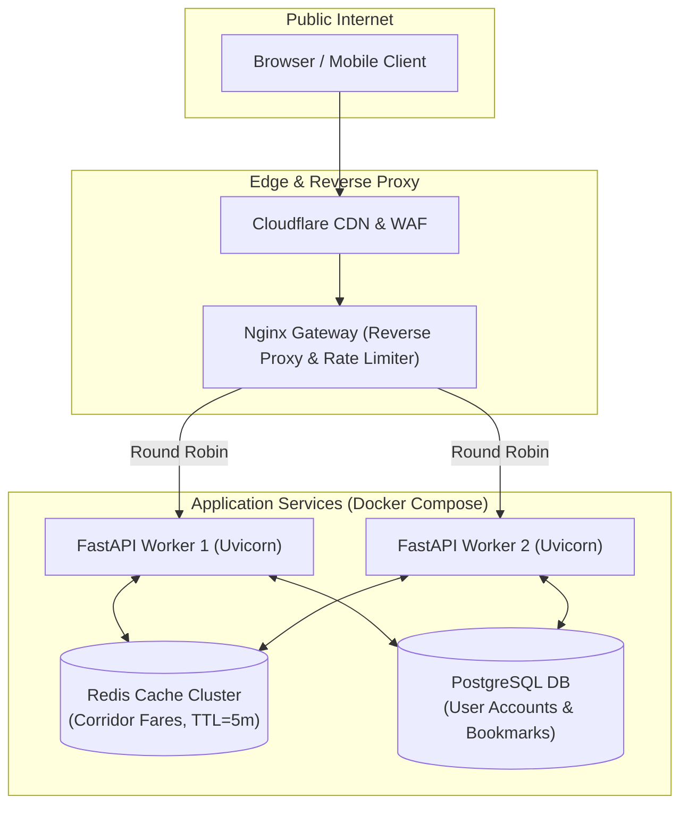

# PART VIII: SETUP, DEPLOYMENT, AND SYSTEM SECURITY

---

## Chapter 29: Reproducible Setup and Execution Guide

This guide provides step-by-step, verified instructions to install, configure, execute, and validate the complete UTRS platform on a clean machine.

---

### 29.1 Prerequisites and Runtime Requirements

1. **Operating System:** Windows 10/11, Ubuntu 22.04/24.04 LTS, or macOS (Apple Silicon / Intel).
2. **Python Runtime:** Python `3.10`, `3.11`, or `3.13` (tested and verified on Python 3.13.0).
3. **Node.js Runtime:** Node.js `v18.x` or `v20.x` LTS with `npm` (v9+).
4. **Memory (RAM):** Minimum 4.0 GB of available physical RAM (8.0 GB recommended due to the in-memory GTFS graph).
5. **Storage:** At least 2.5 GB of free disk space for dependencies and GTFS datasets.

---

### 29.2 Backend Installation and Configuration

#### 1. Navigate to Project Root and Create Virtual Environment
```bash
# Open terminal in the project directory:
cd c:\Users\Harsh\Downloads\BMTC_fixed

# Create Python virtual environment:
python -m venv venv

# Activate virtual environment:
# On Windows (PowerShell):
.\venv\Scripts\Activate.ps1
# On Linux/macOS:
source venv/bin/activate
```

#### 2. Install Python Dependencies
```bash
python -m pip install --upgrade pip
pip install -r requirements.txt
```

#### 3. Configure Environment Variables
Create a `.env` file inside the `backend/` directory based on `backend/.env.example`:

```bash
# backend/.env

# API Keys (Replace with your actual keys; do not commit secrets)
GROQ_API_KEY=your_groq_api_key_here
GEMINI_API_KEY=your_gemini_api_key_here
GOOGLE_MAPS_API_KEY=your_google_maps_api_key_here

# Application Configuration
PORT=8000
HOST=0.0.0.0
ALLOWED_ORIGINS=http://localhost:5173,http://localhost:3000,http://127.0.0.1:5173

# JWT Authentication Secret
JWT_SECRET=super_secret_cryptographic_key_change_in_production
JWT_ALGORITHM=HS256
ACCESS_TOKEN_EXPIRE_MINUTES=1440
```

> [!NOTE]
> If `GROQ_API_KEY` is omitted, the chatbot automatically and gracefully operates using the built-in deterministic rule-based `ChatbotEngine`.

---

### 29.3 Frontend Installation and Configuration

#### 1. Navigate to `frontend/` and Install Dependencies
```bash
cd c:\Users\Harsh\Downloads\BMTC_fixed\frontend
npm install
```

#### 2. Configure Frontend Environment
Verify that `frontend/.env` points to the running backend:

```bash
# frontend/.env
VITE_API_BASE_URL=http://localhost:8000
VITE_GOOGLE_MAPS_API_KEY=your_google_maps_api_key_here
```

---

### 29.4 Starting the Application

#### Terminal 1: Launch Backend Server
```bash
cd c:\Users\Harsh\Downloads\BMTC_fixed\backend
python -m uvicorn main:app --reload --port 8000
```
*Expected Terminal Output:*
```
Database initialized successfully.
Route frequency loaded: 3959 routes
Stop clusters loaded: 5758 unique stop-location keys
Graph built: 193,178 nodes, 193,772 edges (freq-weighted + 3658 reverse routes)
INFO:     Uvicorn running on http://0.0.0.0:8000 (Press CTRL+C to quit)
```

#### Terminal 2: Launch Frontend Client
```bash
cd c:\Users\Harsh\Downloads\BMTC_fixed\frontend
npm run dev
```
*Expected Terminal Output:*
```
  VITE v5.4.x  ready in 320 ms

  ➜  Local:   http://localhost:5173/
  ➜  Network: use --host to expose
```

Open `http://localhost:5173` in any modern web browser.

---

### 29.5 Running the Automated Test Suite

```bash
cd c:\Users\Harsh\Downloads\BMTC_fixed

# Run fast unit tests (pure functions, completes in < 5 seconds):
pytest testing/test_fare.py testing/test_metro_coordinates.py testing/test_weather.py testing/test_stops.py testing/test_gtfs.py

# Run comprehensive integration suite:
pytest testing/test_unified_modes.py testing/test_stop_resolver.py
```

---

## Chapter 30: Production Deployment Architecture

For real-world municipal or commercial deployment, UTRS is designed to run in a containerized Docker architecture behind an Nginx reverse proxy with Redis caching.



### 30.1 Production Dockerfile (`backend/Dockerfile`)
```dockerfile
FROM python:3.11-slim

WORKDIR /app

# Install system dependencies
RUN apt-get update && apt-get install -y --no-install-recommends \
    build-essential \
    curl \
    && rm -rf /var/lib/apt/lists/*

# Install Python requirements
COPY requirements.txt .
RUN pip install --no-cache-dir -r requirements.txt

# Copy application source and datasets
COPY backend/ ./backend/
COPY database/ ./database/

ENV PYTHONPATH=/app/backend
EXPOSE 8000

CMD ["uvicorn", "backend.main:app", "--host", "0.0.0.0", "--port", "8000", "--workers", "4"]
```

---

### 30.2 Nginx Configuration (`nginx.conf`)
```nginx
upstream fastapi_cluster {
    server 127.0.0.1:8000;
    server 127.0.0.1:8001;
    keepalive 32;
}

server {
    listen 80;
    server_name transit.bengaluru.gov.in;
    return 301 https://$host$request_uri;
}

server {
    listen 443 ssl http2;
    server_name transit.bengaluru.gov.in;

    ssl_certificate /etc/letsencrypt/live/transit.bengaluru.gov.in/fullchain.pem;
    ssl_certificate_key /etc/letsencrypt/live/transit.bengaluru.gov.in/privkey.pem;

    # Rate limiting zone: max 30 requests/minute per IP
    limit_req zone=req_limit_per_ip burst=10 nodelay;

    location / {
        root /var/www/frontend/dist;
        try_files $uri $uri/ /index.html;
    }

    location /api/ {
        proxy_pass http://fastapi_cluster;
        proxy_set_header Host $host;
        proxy_set_header X-Real-IP $remote_addr;
        proxy_set_header X-Forwarded-For $proxy_add_x_forwarded_for;
        proxy_set_header X-Forwarded-Proto $scheme;
    }
}
```

---

## Chapter 31: Security, Privacy, and System Reliability

### 31.1 Input Sanitization and Validation
- **Pydantic Validation:** All incoming requests are strictly validated against Pydantic models in [`backend/main.py`](file:///c:/Users/Harsh/Downloads/BMTC_fixed/backend/main.py). Payloads containing negative distances, invalid latitudes (outside $[-90, 90]$), or non-string inputs are automatically rejected with HTTP 422 before reaching the routing engines.
- **SQL Injection Prevention:** All database operations utilize SQLAlchemy parameterized ORM queries in [`backend/db.py`](file:///c:/Users/Harsh/Downloads/BMTC_fixed/backend/db.py). No raw SQL strings are concatenated from user inputs.
- **File Upload Security:** In [`backend/main.py`](file:///c:/Users/Harsh/Downloads/BMTC_fixed/backend/main.py#L5469-L5536), document uploads validate file extensions (`.pdf`, `.jpg`, `.png`), enforce maximum file size limits (10 MB), and generate cryptographically randomized UUID filenames to prevent path-traversal attacks.

---

### 31.2 Authentication, Password Security, and Secrets
- **Password Hashing:** Implemented using `bcrypt` with salt rounds in [`backend/auth.py`](file:///c:/Users/Harsh/Downloads/BMTC_fixed/backend/auth.py). Plaintext passwords are never logged or stored in the database.
- **JWT Authorization:** User sessions are governed by JSON Web Tokens signed with HMAC-SHA256. Protected endpoints (`/api/user/*`) inspect the `Authorization: Bearer <token>` header, verifying token signature and expiration.
- **Secret Isolation:** API keys (Groq, Google Maps, Gemini) are stored strictly in server-side `.env` files and never exposed to the frontend browser bundle.

---

### 31.3 Reliability, Timeouts, and Graceful Fallback Matrix

| External Dependency | Potential Failure Mode | Safeguard / Fallback Strategy | System State |
| :--- | :--- | :--- | :---: |
| **Groq Cloud API** | Timeout ($> 8.0\text{ s}$), Rate Limit, Outage | Catch exception $\rightarrow$ return `None` $\rightarrow$ delegate to deterministic `ChatbotEngine` | **100% Functional** |
| **Open-Meteo API** | Network connection dropped, DNS error | Fallback to cached default weather state (`"clear"`, $0\%$ rain) | **100% Functional** |
| **Google Maps OSRM** | API quota exceeded | Fallback to great-circle Haversine distance with $1.30\times$ urban detour index | **100% Functional** |
| **GTFS Raw Schedule** | Missing reverse route schedule in GTFS | Fallback to `reverse_routes_supplement.csv` geometry inversion | **100% Functional** |

---
*(End of Part VIII — Proceed to [Part IX: Feature Implementation Audit and Final Reference](file:///c:/Users/Harsh/Downloads/BMTC_fixed/project_info/09_FEATURE_IMPLEMENTATION_AUDIT.md))*
